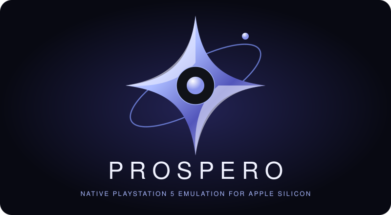
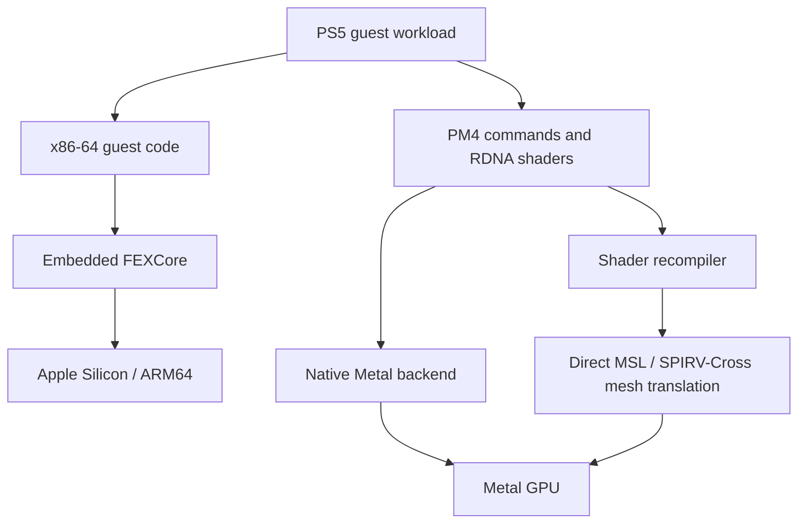

  

  
  
  
  
  

  <a href="#architecture">Architecture</a> ·
  <a href="#compatibility">Compatibility</a> ·
  <a href="#build-and-test">Building</a> ·
  <a href="#open-games">Launcher</a> ·
  <a href="#contributing">Contributing</a> ·
  <a href="#credits">Credits</a>

---

# Prospero

**Prospero** is a fork of [KyTx](https://github.com/TxCsOffc/KyTx) focused on
making native Apple Silicon PlayStation 5 emulation easier to build, test and use.
KyTx builds on [KytyPS5](https://github.com/KytyPS5/KytyPS5) and
[Kyty](https://github.com/InoriRus/Kyty).
It replaces the upstream x86-64 + Rosetta 2 + MoltenVK setup with a native ARM64 build:

- **Guest CPU:** x86-64 game code runs under [FEX](https://github.com/FEX-Emu/FEX) (FEXCore embedded in-process),
  not Rosetta 2.
- **GPU:** PM4 command streams execute on a native Metal backend (`src/graphics/host_gpu/metal/`).
  The shader recompiler emits Metal Shading Language directly for supported stages and uses SPIRV-Cross for mesh translation.

> [!IMPORTANT]
> Prospero is not affiliated with Sony Interactive Entertainment, PlayStation or any game publisher. The project does not
> distribute games, game data or copyrighted system software. Use only game files that you have obtained legally.

## Architecture

| Subsystem | Approach |
| :--- | :--- |
| Host CPU | Native ARM64 on Apple Silicon |
| Guest CPU | x86-64 execution via embedded [FEXCore](https://github.com/FEX-Emu/FEX), without Rosetta 2 |
| Graphics commands | PM4 command streams executed by a native Metal backend |
| Shader translation | Direct Metal Shading Language (MSL) for supported stages; SPIRV-Cross for mesh translation |
| Graphics API | Native Metal backend, without MoltenVK |
| Diagnostic reference | Inherited Vulkan renderer retained for comparison |

The native graphics implementation lives in [`src/graphics/host_gpu/metal/`](src/graphics/host_gpu/metal/). The diagram is a high-level overview, not a complete execution model.

## Compatibility

> [!WARNING]
> Prospero remains experimental. These are reported development observations, not guarantees of compatibility or independently reproduced benchmarks.

| Game | Hardware | Observed progress | Known limitations |
| :--- | :--- | :--- | :--- |
| Is This Seat Taken? | Mac mini M4 | Title menu, Barcelona map and first level | Audio remains unverified |
| Gran Turismo 7 1.71 | Mac mini M4 | World Map; approximately 8 FPS median in two documented runs | Incomplete landscape and missing menu labels; see [GT7 findings](docs/bringup/gt7-metal.md) |
| EA SPORTS FC 27 | M5 Max | Main menu and match in original KyTx testing | Rendering errors, occasional crashes and GPU hangs; not independently retested on Prospero |

Prospero is an experimental macOS build for Apple Silicon with Metal 4.

### Requirements

- Apple Silicon Mac with a Metal 4 capable GPU.
- macOS, Xcode and the native build dependencies specified in the ARM64 guide.
- The pinned external FEXCore dependency described in the guide.
- Legally obtained game files.

## Build and test

Follow the [macOS ARM64 build guide](docs/bringup/macos-arm64.md) for the pinned
FEXCore revision, dependencies and game launch command. The
[GT7 bring-up notes](docs/bringup/gt7-metal.md) list the descriptor and shader
regression tests and explain how to reproduce the Metal captures.

## Open games

Build the native launcher with `bash tools/build_prospero_launcher.sh /path/to/build/kytx`.
Open `Prospero.app` beside `kyty_emulator`, then add a game directory, .pkg, or
.fpkg to the library. You can also use Finder's **Open With** menu for package files.

Prospero starts games in a 1920×1080 window and defaults to 1080p Video Out and
a 60 Hz virtual refresh rate. **Settings → Video** controls the mode reported to
the game. Games choose their internal render resolution.

For supported PS5 packages, Prospero streams the original file using a compatible
`read-fpkg` helper. The launcher looks beside the emulator and in
`../fpkg-reader/read-fpkg` relative to the emulator directory. Use **Settings →
Package reader** to select a helper elsewhere. The helper and its dependencies
are separate from the launcher. A game-specific JSON patch can be selected in
**Game Options**.

## Development priorities

The following areas are proposed priorities for improving the project:

- [ ] Validate the documented ARM64 build on fresh systems.
- [ ] Improve shader translation and rendering correctness.
- [ ] Investigate GPU hangs and runtime stability.
- [ ] Establish repeatable compatibility and performance tests.
- [ ] Expand testing across Apple Silicon hardware and additional titles.

Diagnostic environment variables, including `KYTY_PASS_TRACE_*`, `KYTY_GPU_BUSY` and `KYTY_GPU_PASS_TIME`, are documented alongside the implementation. Inherited documentation is available in [`docs/`](docs/).

## Contributing

Contributions to graphics correctness, CPU integration, build reproducibility and documentation are welcome.

Before submitting a change, describe the problem, keep the patch focused and include reproduction steps or test results where possible. For a bug report, include the macOS version, Apple Silicon model, memory configuration, commit SHA, relevant logs and expected versus actual behavior.

- [Report an issue](https://github.com/LuizDusky/Prospero/issues)
- [Browse pull requests](https://github.com/LuizDusky/Prospero/pulls)

Do not attach copyrighted game files, firmware, keys or other material you are not authorized to distribute.

## Credits

Prospero builds on the work of the open-source emulation community:

- [KyTx](https://github.com/TxCsOffc/KyTx), the immediate upstream project.
- [Kyty](https://github.com/InoriRus/Kyty) by InoriRus and contributors.
- [KytyPS5](https://github.com/KytyPS5/KytyPS5) and its contributors.
- The KytyPS5-UFC5 fork by Reece Ketley.
- [FEX](https://github.com/FEX-Emu/FEX) (MIT).

## License

GPL-2.0, as upstream. See [LICENSE](LICENSE) and [LICENSES/](LICENSES/) for licensing details.

Prospero is an independent project and is not affiliated with Sony Interactive Entertainment, PlayStation or any game publisher. It does not distribute games, game data or copyrighted system software. Use only game files you have obtained legally.

---

Prospero · Experimental native PS5 emulation for Apple Silicon

