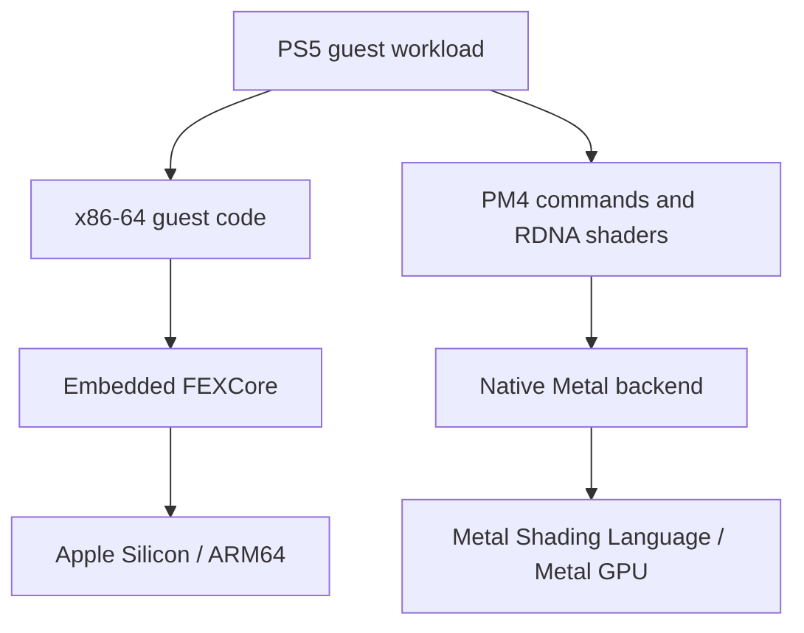

<p align="center">
  
</p>

<p align="center">
  <a href="#architecture"></a>
  <a href="#requirements"></a>
  <a href="#architecture"></a>
  <a href="#compatibility"></a>
  <a href="LICENSE"></a>
</p>

<p align="center">
  <a href="#architecture">Architecture</a> ·
  <a href="#compatibility">Compatibility</a> ·
  <a href="#building">Building</a> ·
  <a href="#contributing">Contributing</a> ·
  <a href="#credits">Credits</a>
</p>

---

# Prospero

**An experimental PlayStation 5 emulator built around Apple Silicon.**

Prospero explores a native ARM64 host architecture for PS5 emulation on macOS, building on [KyTx](https://github.com/TxCsOffc/KyTx), [KytyPS5](https://github.com/KytyPS5/KytyPS5) and [Kyty](https://github.com/InoriRus/Kyty). Rather than relying on Rosetta 2 and MoltenVK, it embeds FEXCore for guest CPU execution and implements a native Metal graphics backend.

> [!WARNING]
> Prospero is in early development. Rendering errors, crashes and GPU hangs are known limitations. Broad game compatibility, full-speed gameplay and reproducible public builds are not yet established.

## Architecture

| Subsystem | Approach |
| :--- | :--- |
| Host CPU | Native ARM64 on Apple Silicon |
| Guest CPU | x86-64 execution via embedded [FEXCore](https://github.com/FEX-Emu/FEX), without Rosetta 2 |
| Graphics commands | PM4 command streams executed by a native Metal backend |
| Shader translation | RDNA to Metal Shading Language (MSL) |
| Graphics API | Metal; no Vulkan, MoltenVK or SPIRV-Cross on the intended native path |
| Diagnostic reference | Inherited Vulkan renderer retained for comparison |



The native graphics implementation lives in [`src/graphics/host_gpu/metal/`](src/graphics/host_gpu/metal/). The diagram is a high-level overview, not a complete execution model.

## Compatibility

Development observations on an **M5 Max with 48 GB of memory**:

| Title | Menu | In-game | Known limitations |
| :--- | :--- | :--- | :--- |
| EA SPORTS FC 27 | Boots, 30 FPS (game cap) | Match gameplay, 30–37 FPS (60 FPS target) | Significant rendering errors, occasional crashes and GPU hangs |
| Other titles, including UFC 5 | Untested on main | Untested on main | See pending branch observations below |

These are preliminary developer observations, not independently reproduced benchmarks or a guarantee of compatibility.

### Development branches — pending integration

The following observations and features are reported in open pull requests, not in the current main build.

| Title | Development observation | Branch |
| :--- | :--- | :--- |
| Is This Seat Taken? | Mac mini M4: title menu, Barcelona map and first level reached; audio remains unverified. | [ARM64 / Unity bring-up](https://github.com/LuizDusky/Prospero/pull/2) |
| Gran Turismo 7 1.71 | Mac mini M4: World Map reached, with incomplete landscape and missing menu text; approximately 8 FPS median in two documented map runs. | [GT7 Metal bring-up](https://github.com/LuizDusky/Prospero/pull/6) |

The GT7 branch also introduces a native macOS launcher, a game library, configurable video output, package import via a separate compatible reader, and a pinned external FEXCore build guide. Its graphics path adds SPIRV-Cross mesh translation alongside direct MSL emission for supported stages. These changes are under review and should not be assumed available on main.

Other integration reviews: [storage-image component selectors](https://github.com/LuizDusky/Prospero/pull/3), [sRGB presentation](https://github.com/LuizDusky/Prospero/pull/4), and [compute LDS preservation](https://github.com/LuizDusky/Prospero/pull/5).

See the branch-specific [ARM64 build guide](https://github.com/LuizDusky/Prospero/blob/prospero/gt7-metal/docs/bringup/macos-arm64.md) and [GT7 technical notes](https://github.com/LuizDusky/Prospero/blob/prospero/gt7-metal/docs/bringup/gt7-metal.md) for details. These reports are developer observations, not independent verification.

## Requirements

- Apple Silicon Mac with a Metal 4 capable GPU.
- macOS; Windows and Linux are not supported by this fork, although inherited platform code remains in the tree.
- CMake and the required native build toolchain.
- A compatible FEX-darwin source/build tree (currently external to this repository).
- Legally obtained game files.

The M5 Max is the development machine, not a verified minimum hardware specification.

## Building

> [!IMPORTANT]
> A fresh clone alone is not sufficient to build Prospero today. The FEX-darwin dependency is not yet included in the repository, and the commands below assume an existing configured CMake build directory.

CMake looks for FEX-darwin at `~/Developer/fex-darwin`. Override the relevant paths with `KYTY_FEX_DIR`, `KYTY_FEX_BUILD_DIR` and `KYTY_FEX_SHIMS_DIR`.

With those dependencies and the build directory configured:

```bash
cmake --build _Build/macos-arm64 --target kyty_emulator -j$(sysctl -n hw.logicalcpu)
```

Run using the native Metal backend:

```bash
KYTY_BACKEND=metal KYTY_MSL_ONLY=1 KYTY_VIDEO_OUT_1080P=1 \
  _Build/macos-arm64/kyty_emulator --game /path/to/your/game
```

## Development priorities

The following areas are proposed priorities for improving the project:

- [ ] Document a reproducible ARM64 build and external FEX dependency setup.
- [ ] Improve shader translation and rendering correctness.
- [ ] Investigate GPU hangs and runtime stability.
- [ ] Establish repeatable compatibility and performance tests.
- [ ] Expand testing across Apple Silicon hardware and additional titles.

Diagnostic environment variables, including `KYTY_PASS_TRACE_*`, `KYTY_GPU_BUSY` and `KYTY_GPU_PASS_TIME`, are documented alongside the implementation. Inherited documentation is available in [`docs/`](docs/).

## Contributing

Contributions to graphics correctness, CPU integration, build reproducibility and documentation are welcome.

Before submitting a change, describe the problem, keep the patch focused and include reproduction steps or test results where possible. For a bug report, include the macOS version, Apple Silicon model, memory configuration, commit SHA, relevant logs and expected versus actual behavior.

- [Report an issue](https://github.com/LuizDusky/Prospero/issues)
- [Browse pull requests](https://github.com/LuizDusky/Prospero/pulls)

Do not attach copyrighted game files, firmware, keys or other material you are not authorized to distribute.

## Credits

Prospero builds on the work of the open-source emulation community:

- [KyTx](https://github.com/TxCsOffc/KyTx), the immediate upstream project.

- [Kyty](https://github.com/InoriRus/Kyty) by InoriRus and contributors.
- [KytyPS5](https://github.com/KytyPS5/KytyPS5) and its contributors.
- The KytyPS5-UFC5 fork by Reece Ketley.
- [FEX](https://github.com/FEX-Emu/FEX) (MIT).

## License

GPL-2.0, as upstream. See [LICENSE](LICENSE) and [LICENSES/](LICENSES/) for licensing details.

Prospero is an independent project and is not affiliated with Sony Interactive Entertainment, PlayStation or any game publisher. It does not distribute games, game data or copyrighted system software. Use only game files you have obtained legally.

---

<p align="center"><sub>Prospero · Experimental native PS5 emulation for Apple Silicon</sub></p>
